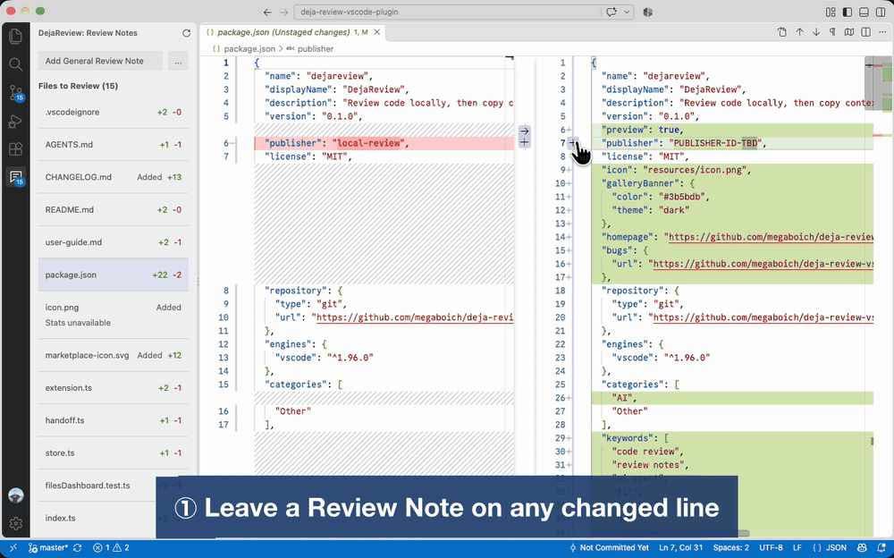

# DejaReview

**Review code where you work. Send your AI one clear review pass.**

DejaReview brings your feedback together in a single **Review Notes** panel in VS Code. Leave a note beside the code or add a general request for the whole review, refine your feedback in the panel, then copy it into any AI tool. No manually copying file paths, line numbers, or code snippets: file-specific notes capture that context for you.

- **Keep feedback in context.** Select code in a file or diff and write what needs to change. DejaReview remembers the selected revision and comparison side.
- **Say more than line comments allow.** Add general feedback about design, tests, or the next iteration without opening a file.
- **Manage one review pass in one place.** Browse changed files, revisit notes, and edit any saved note from its card.
- **Hand off without losing your review.** Copy saved feedback with instructions for your agent, keep the last copied batch for local recovery, and start the next pass with a clear panel.

The loop is simple: **review changes, stage what you approve, leave notes for what needs work, copy the review, repeat.** DejaReview does not run an AI or require an account.

## Install

1. In VS Code, open **Extensions** (**Cmd+Shift+X** on macOS, **Ctrl+Shift+X** elsewhere), search for **DejaReview**, and select **Install**. Or run `code --install-extension OleksandrBoiko.dejareview`.
2. Open a local folder inside a Git repository, then open the **Review Notes** panel.

To install from a `.vsix` file instead, choose **Install from VSIX...** from the **...** menu in the Extensions view.

Requires **VS Code 1.96+**, Git, and VS Code's bundled Git extension. Notes are remembered per project folder automatically. In a multi-root workspace, only the first folder is used.

## How To Use It

1. **Add notes.** Select lines and press **Ctrl+Alt+M** (**Cmd+Alt+M** on macOS), or click **+** in the gutter. Use **Add General Review Note** in the panel for feedback not tied to code, or the note button on a file row for a whole-file note.
2. **Refine.** Click a card to jump to its code; hover it to edit or delete. Notes can be edited in the gutter or the panel.
3. **Work through changed files.** **Files to Review** lists changed files you have not commented on yet, with **Stage File** and **Revert File** on each row. Staging the first row opens the next file.
4. **Send.** Click **Copy Review Notes & Clear** and paste into your AI tool. The copy includes file paths, code snippets, and an instruction to leave staging to you.
5. **Recover if needed.** Forgot to paste? **More actions (...) → Restore Last Copied Review Notes** brings back the last copied batch.

## Good To Know

- **Staging is yours.** DejaReview stages or reverts only one file at a time, and only when you click. Revert asks first, and restores the staged version, not HEAD.
- **Nothing leaves your machine** until you paste it. Notes are stored in VS Code's extension storage, not in your project.
- **Files to Review is a guide, not an approval.** An empty list means no uncommented changes, not that the review is done.

## More Details

- [User Guide](docs/user-guide.md): full workflow, Files to Review behaviour, safety, storage, recovery, limitations, and the clipboard format.
- [Design Notes](docs/README.md): how the extension works inside.
- `AGENTS.md`: building, testing, and contributor rules.
